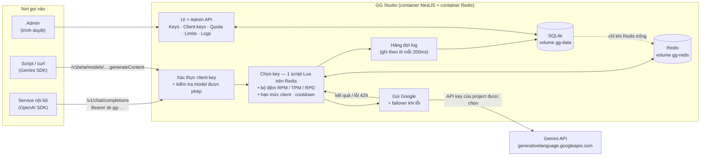

# GG Studio — Gemini Key Pool Gateway

Gateway nội bộ đứng trước Gemini API: gom nhiều API key free tier (mỗi project một key) thành một pool, tự chọn key còn quota cho từng request, và cấp key riêng cho từng service/người dùng gọi vào theo chuẩn OpenAI.

## Mục đích

Free tier của Gemini API giới hạn theo **project** (ví dụ Gemini 2.5 Flash: 5 request/phút, 20 request/ngày mỗi project). Một project thì quá ít để dùng thật. Gateway này giải quyết bốn việc:

1. **Quản lý key**: paste lệnh curl từ AI Studio, hệ thống tự tách API key, gắn nhãn account + project.
2. **Biết còn bao nhiêu quota**: lưu bảng limit free tier (paste nguyên bảng từ AI Studio) và đếm usage từng key theo từng model.
3. **Tự chọn key**: request tới model nào thì chọn key còn quota cho model đó, chia đều tải; key bị Google từ chối thì tự chuyển key khác.
4. **Cấp quyền cho nơi khác dùng**: tạo client key (`sk-gg-…`), chọn model được phép, bên dùng gọi như OpenAI API.

## Kiến trúc



### Đường đi của một request

1. **Xác thực**: so mã băm của client key với cache trong RAM, kiểm tra model có nằm trong danh sách được phép.
2. **Chọn key** (một lượt gọi Redis, không có lệnh SQL): script Lua bỏ key đang cooldown hoặc đã chạm RPM/TPM/RPD, lấy key **đã dùng ít nhất** cho model đó (hoà thì xoay vòng) và **cộng bộ đếm ngay** trong cùng script, nên request tới sau luôn thấy số của request tới trước.
3. **Gọi Google** bằng key vừa chọn.
4. **Xử lý kết quả**:

| Google trả về | Gateway làm gì |
|---|---|
| 200 | Cập nhật số token thật, trả kết quả |
| 429 quota theo ngày | Khoá cặp key + model tới 00:00 giờ Pacific, thử key khác |
| 429 khác (quota theo phút, hoặc Google không nói rõ) | Khoá theo `retryDelay` (mặc định 60s), thử key khác. Cặp key + model bị 429 liên tiếp thì mỗi lần khoá gấp đôi, tối đa 1 giờ; có request thành công thì tính lại từ đầu |
| Key không hợp lệ / project bị khoá | Tắt hẳn key, thử key khác |
| 403 khác | Khoá cặp key + model 1 giờ, thử key khác |
| 5xx, lỗi mạng | Không phạt key, thử key khác |
| 400 / 404 | Trả nguyên lỗi cho client, không thử lại |

Thử tối đa `MAX_ATTEMPTS` key cho một request. Hết key thì trả 429 kèm `Retry-After`.

### Redis giữ trạng thái quota, SQLite giữ log

- **Redis** (bắt buộc) giữ mọi thứ quyết định việc chọn key: bộ đếm RPM/TPM/RPD theo từng cặp key + model, hạn mức ngày của client key, cooldown, con trỏ xoay vòng. Tiến trình Node không giữ bộ đếm nào trong RAM; key trong Redis tự hết hạn (cửa sổ phút sau 2 phút, bộ đếm ngày sau khi sang ngày).
- Kiểm tra quota và cộng bộ đếm nằm trong **một script Lua** nên là nguyên tử: 30 request tới cùng lúc không thể cùng lấy slot cuối.
- **SQLite** chỉ lưu cấu hình (key, limits, client key) và log request cho trang Logs / thống kê. Log được ghi theo lô mỗi 200ms, không nằm trên đường chọn key.
- Redis trống (lần đầu chạy bản này, hoặc Redis mất dữ liệu) thì lúc khởi động gateway dựng lại bộ đếm hôm nay từ log trong SQLite.
- Redis không kết nối được: app không khởi động; rớt giữa chừng thì request nhận 503 kèm `Retry-After` thay vì gọi mù lên Google.
- Vẫn chỉ chạy **một** replica của gateway: bộ đếm đã dùng chung qua Redis, nhưng file SQLite và việc cấp id cho log vẫn thuộc về một tiến trình.

## Chạy

### Dev

```bash
docker run -d --name gg-redis-dev -p 6379:6379 redis:7-alpine
npm install
npm run start:dev
```

Gateway cần Redis ở `REDIS_URL` (mặc định `redis://127.0.0.1:6379`). `npm test` cũng cần Redis đó; test dùng prefix riêng nên không đụng dữ liệu dev.

Mở `http://127.0.0.1:3000/`.

### Docker

File `.env` (xem `.env.example`) cần có `ADMIN_TOKEN`, `PROXY_TOKEN`; `HOST_PORT` là cổng mở ra ngoài (mặc định 4041).

```bash
docker compose up -d --build
```

- Từ ngoài vào: `http://<ip-server>:4041/`
- Service cùng docker network: `http://gg-studio:3000`
- Stack khác trên cùng máy (ví dụ Logis): gateway tham gia network dùng chung `proxy_net` với tên `gg-studio`, nên stack nào cũng gắn vào `proxy_net` gọi được `http://gg-studio:3000/v1` mà không đi vòng ra internet. Network này phải có trước khi deploy, tạo một lần bằng `docker network create proxy_net`. Lưu ý `0.0.0.0` chỉ là địa chỉ lắng nghe, container khác không gọi tới nó được.
- Compose chạy kèm service `gg-redis` (bộ đếm quota, volume `gg-redis`, bật AOF); gateway chờ Redis sẵn sàng rồi mới lên.
- Dữ liệu nằm trong volume `gg-data`. `docker compose down` giữ dữ liệu; `docker compose down -v` **xoá** dữ liệu.

### Coolify

1. Tạo Application từ repo này, Build Pack chọn **Docker Compose** (file `docker-compose.yml`).
2. Vào **Environment Variables → Developer view**, dán nội dung file `.env.coolify` (mẫu: `.env.coolify.example`).
3. Deploy. Gateway mở ở `http://<ip-server>:4041/`. Nếu gắn domain trong Coolify thì trỏ domain vào cổng container `3000`.
4. Dữ liệu nằm trong volume `gg-data` và `gg-redis` khai báo sẵn trong compose, redeploy không mất. Redis đi kèm trong compose, không cần tạo riêng; muốn dùng Redis có sẵn thì đặt `REDIS_URL`.
5. Chuyển dữ liệu từ máy dev lên: **Export** ở máy dev, rồi **Import** trên UI của server.

Chỉ chạy **một** replica của gateway (file SQLite và id log thuộc về một tiến trình).

## Sử dụng

### 1. Thêm key Google (trang **Keys Google**, `/keys`)

Paste lệnh curl lấy từ AI Studio (hoặc chỉ API key), điền account và project. Mỗi project chỉ nhận một key vì quota tính theo project.

### 2. Cập nhật bảng limit (trang **Limits**, `/limits`)

Copy nguyên bảng Rate limits trên AI Studio, paste vào ô import. Chỉ những model dùng được qua gateway mới được nạp: bỏ qua model có limit 0, nhóm Agents (cần Interactions API) và Live API (WebSocket). Usage không bị ảnh hưởng. Cột alias dùng để khớp tên model client gửi lên (ví dụ `gemini-flash-latest`).

### 3. Cấp key cho nơi dùng (trang **Client keys**, `/clients`)

Nhập tên, chọn **mục đích** (Chat / text, Embedding, TTS, Sinh ảnh...) để tự tick các model thuộc loại đó hoặc tick tay từng model (không tick = mọi model), bấm tạo. Kèm theo là lệnh curl mẫu, chọn được gọi qua **Domain** (từ ngoài vào) hay **Local** (service cùng docker network hoặc cùng máy) và theo chuẩn OpenAI hay Gemini. Địa chỉ mặc định lấy từ `PUBLIC_BASE_URL` / `LOCAL_BASE_URL`, sửa được ngay trên UI; bấm vào **key** ở mỗi dòng để mở thông tin của key (trạng thái, model được phép, lượng dùng hôm nay) kèm lệnh mẫu đúng endpoint cho từng loại model. Trong đó có nút **Hiện** / **Copy key** để xem lại key đầy đủ (key tạo từ bản cũ chỉ có mã băm nên không xem lại được, cần tạo key mới).

**Gateway tự chọn model.** Với client key có tick model, bên gọi không cần biết tên model thật: gửi một tên không có trong bảng limits (ví dụ `auto`, hoặc tên của key) thì gateway thử lần lượt các model của key theo thứ tự trong bảng, model nào hết quota trên mọi key Google (hoặc Google báo không tồn tại) thì sang model kế. Chỉ model hợp với endpoint mới được xét: chat completions không chọn model embedding hay TTS. Header `x-gg-model` trong response cho biết model đã dùng. Nếu bên gọi gửi đúng tên một model có trong bảng thì gateway dùng đúng model đó, không tự đổi. Key không tick model nào thì bắt buộc phải gửi tên model thật.

### 4. Gọi API

Chuẩn OpenAI:

```bash
curl http://<server>:4041/v1/chat/completions \
  -H "Authorization: Bearer sk-gg-..." \
  -H "Content-Type: application/json" \
  -d '{"model":"gemini-2.5-flash","messages":[{"role":"user","content":"Xin chào"}]}'
```

```python
from openai import OpenAI
client = OpenAI(api_key="sk-gg-...", base_url="http://<server>:4041/v1")
```

Chuẩn Gemini (key gửi qua `x-goog-api-key`):

```bash
curl "http://<server>:4041/v1beta/models/gemini-2.5-flash:generateContent" \
  -H "x-goog-api-key: sk-gg-..." -H "Content-Type: application/json" \
  -d '{"contents":[{"parts":[{"text":"Xin chào"}]}]}'
```

| Endpoint | Ghi chú |
|---|---|
| `POST /v1/chat/completions` | OpenAI, có stream |
| `POST /v1/embeddings` | OpenAI |
| `GET /v1/models` | Key bị giới hạn chỉ thấy model của nó |
| `POST /v1beta/models/{model}:generateContent` | Gemini gốc, kể cả `streamGenerateContent`, `embedContent` |
| `GET /healthz` | Healthcheck |

Mã lỗi từ gateway: `401` key sai/bị tắt, `403` model không được phép, `400` model chưa có trong bảng limits, `429` hết quota (xem `Retry-After`).

### 5. Chuyển dữ liệu giữa các máy

Nút **Export** tải về file JSON gồm key Google, client keys, limits, usage, cooldown. Nút **Import** trên máy đích có hai chế độ: gộp thêm, hoặc thay toàn bộ để máy đích y chang file. File chứa API key dạng plaintext, chỉ gửi qua kênh an toàn.

## Cấu hình

| Biến | Mặc định | Ý nghĩa |
|---|---|---|
| `HOST_PORT` | `4041` | Cổng Docker mở ra ngoài |
| `BIND_ADDR` | `0.0.0.0` | Địa chỉ Docker bind cổng |
| `PORT` / `HOST` | `3000` / `127.0.0.1` | Khi chạy trực tiếp bằng Node |
| `ADMIN_TOKEN` | trống | Bảo vệ UI và admin API (`x-admin-token`) |
| `PROXY_TOKEN` | trống | Key chủ gọi proxy, dùng mọi model |
| `MAX_ATTEMPTS` | `4` | Số key tối đa thử cho một request |
| `DB_PATH` | `./data/gg-studio.db` | File SQLite |
| `REDIS_URL` | `redis://127.0.0.1:6379` (compose: `redis://gg-redis:6379`) | Redis giữ bộ đếm quota và cooldown, bắt buộc |
| `REDIS_PREFIX` | `gg:` | Prefix key, đổi khi nhiều môi trường dùng chung một Redis |

Khi chưa đặt `PROXY_TOKEN` và chưa tạo client key nào, proxy mở cho mọi request (tiện dev). Có ít nhất một client key thì bắt buộc phải gửi key.

## Cấu trúc mã nguồn

```
src/
  keys/      key Google + parser lệnh curl
  limits/    bảng limit free tier + parser bảng AI Studio
  clients/   client key cấp cho nơi dùng
  router/    chọn key trên Redis (quota.service), proxy + failover (gemini-proxy.controller)
  backup/    export / import
  db/        SQLite schema
  redis/     kết nối Redis
  ui/        dashboard: UiController (mỗi trang một URL: /keys /clients /quota /limits /logs), cấu hình view engine
views/       template Handlebars: layout.hbs, pages/ (mỗi trang một file), partials/header.hbs
public/      file tĩnh: css/app.css, js/ (mỗi trang một file, core.js dùng chung, app.js khởi động)
```

## Lưu ý

- Số "đã dùng" là số gateway tự đếm. Request gọi thẳng vào project từ AI Studio hay app khác không được đếm; khi đó Google trả 429 và gateway tự cooldown key.
- RPD reset lúc 00:00 giờ Pacific; RPM/TPM tính theo cửa sổ trượt 60 giây.
- Limit free tier do Google đặt và có thể đổi bất cứ lúc nào: paste lại bảng ở trang Limits.
- Điều khoản Google API cấm lách giới hạn sử dụng; gom nhiều account/project để cộng dồn free tier có rủi ro bị khoá key hoặc account.
- API key Google và client key đều lưu plaintext trong SQLite (client key được xác thực qua mã băm, bản plaintext chỉ để xem lại trên UI): giữ kín file DB, file backup và `ADMIN_TOKEN`.
